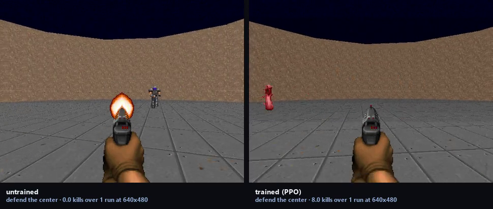

# DOOM, from pixels

**The game:** DOOM (Freedoom data) — `vizdoom` on PyPI, which embeds the engine and ships Freedoom.
**How the agent plays it:** PPO written out rather than imported, trained from raw frames on CPU.

Three maps, not one: defend the center, health gathering and deadly corridor. One map cannot tell *learned DOOM* from *learned one room*.



*Untrained on the left, trained on the right, same episode. The labels carry the
scores measured at the resolution being filmed.*

[Eight-second demonstration](media/demo.mp4) · [as a gif](media/demo.gif)

### Result

| agent | mean | sd | min | max |
|---|---:|---:|---:|---:|
| random | 0.00 | 0.91 | -1.0 | 2.0 |
| spray | 1.23 | 0.82 | 0.0 | 2.0 |
| ppo-greedy | 9.80 | 1.47 | 6.0 | 12.0 |
| ppo-sampled | 9.23 | 1.33 | 7.0 | 12.0 |

*30 held-out episodes, the same maps for every agent.*

Against the better baseline (spray): **+8.57** with a bar of
**0.61** — learned.

### Running it

```bash
python -m doomagent.train --scenario defend_the_center
python evaluate.py --scenario defend_the_center --episodes 30
python film.py --scenario defend_the_center --resolution 640x480
```

Scored under [`protocol.py`](../protocol.py): the checkpoint ladder is scored on
one set of episodes, the best checkpoint is re-scored on a disjoint set, and a
gain counts only if it clears two standard errors of the difference.
