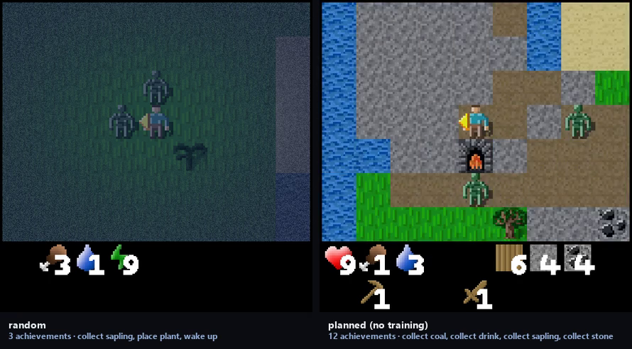

# Crafter, planned

**The game:** Crafter — `crafter` on PyPI.
**How the agent plays it:** tile decoding into a map, then a goal ladder — no training at all.

The agent has no weights. It reads the 64×64 frame into a grid of named tiles and chooses a goal; the comparison is against a random agent on the same seed.



*Untrained on the left, trained on the right, same episode. The labels carry the
scores measured at the resolution being filmed.*

[Eight-second demonstration](media/demo.mp4) · [as a gif](media/demo.gif)

### Result

| agent | Crafter score (%) |
|---|---:|
| random | 1.13 |
| **planner (no training)** | **12.73** |

*10 episodes, geometric mean of achievement rates over fixed episodes.*

Achievements unlocked: **15** against 5 for the random agent.

Gain **+11.60** against no error bar — no error bar: the Crafter score is a geometric mean over achievement rates, not a mean over episodes — no error bar.

### Running it

```bash
python evaluate.py --agent all --episodes 20
python film.py --seed 11 --length 350
```

Scored under [`protocol.py`](../protocol.py): the checkpoint ladder is scored on
one set of episodes, the best checkpoint is re-scored on a disjoint set, and a
gain counts only if it clears two standard errors of the difference.
