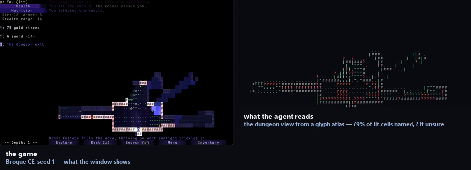

# Brogue, through the screen

**The game:** Brogue CE — the GPL release, fetched by `scripts/get_brogue.py`.
**How the agent plays it:** screenshots in, keystrokes out — no API, no memory reading.

The one honest failure in the set: over 300 keystrokes the explorer does not descend more often than random keystrokes do.



*Untrained on the left, trained on the right, same episode. The labels carry the
scores measured at the resolution being filmed.*

[Eight-second demonstration](media/demo.mp4) · [as a gif](media/demo.gif)

### Result

| agent | descents in 300 keystrokes |
|---|---:|
| random keystrokes | 1.33 |
| **explorer (screen-driven)** | **1.00** |

*6 episodes, fixed seeds, same dungeon for both agents.*

Gain **-0.33** against a bar of 1.33 — inside noise.

### Running it

```bash
python play.py --seeds 1 2 3 4 5 --steps 300 --agent explorer
python film.py --seed 1
```

Scored under [`protocol.py`](../protocol.py): the checkpoint ladder is scored on
one set of episodes, the best checkpoint is re-scored on a disjoint set, and a
gain counts only if it clears two standard errors of the difference.
