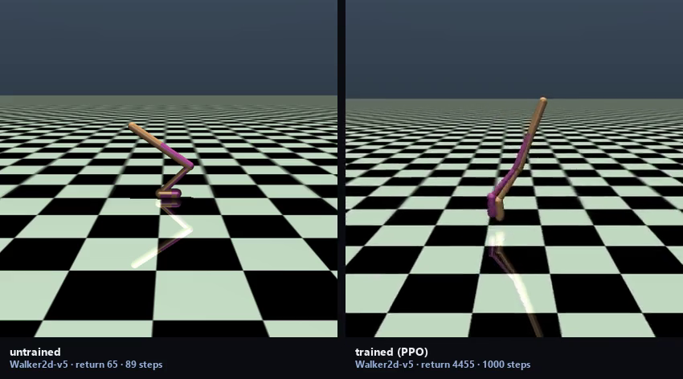

# A robot learns to walk

**The game:** MuJoCo Walker2d — `mujoco` and `gymnasium` on PyPI.
**How the agent plays it:** PPO with a Gaussian policy — an action is a torque per joint.

The only agent here whose actions are not buttons.



*Untrained on the left, trained on the right, same episode. The labels carry the
scores measured at the resolution being filmed.*

[Eight-second demonstration](media/demo.mp4) · [as a gif](media/demo.gif)

### Result

| checkpoint | steps | return | ± se |
|---|---:|---:|---:|
| ckpt_000 | 0 | 64.94 | 0.60 |
| ckpt_049 | 100,352 | 430.21 | 0.83 |
| ckpt_146 | 299,008 | 883.39 | 28.14 |
| ckpt_342 | 700,416 | 4,494.43 | 11.46 |
| ckpt_634 | 1,298,432 | 4,242.45 | 243.82 |
| ckpt_976 | 1,998,848 | 3,636.73 | 392.80 |

*Scored on 12 selection episodes, the same ones for every row.*

Best: **ckpt_342**, re-scored on 12 held-out episodes: **4,497.88 ± 14.20** against **65.09 ± 0.47** untrained — learned, +4,432.79 against a bar of 28.41.

This run peaked in the middle: it lost 858 return between its best checkpoint and the end of training.

### Running it

```bash
python -m walker.train --env Walker2d-v5 --steps 2000000
python evaluate.py --episodes 20
python film.py --seed 3
```

Scored under [`protocol.py`](../protocol.py): the checkpoint ladder is scored on
one set of episodes, the best checkpoint is re-scored on a disjoint set, and a
gain counts only if it clears two standard errors of the difference.
