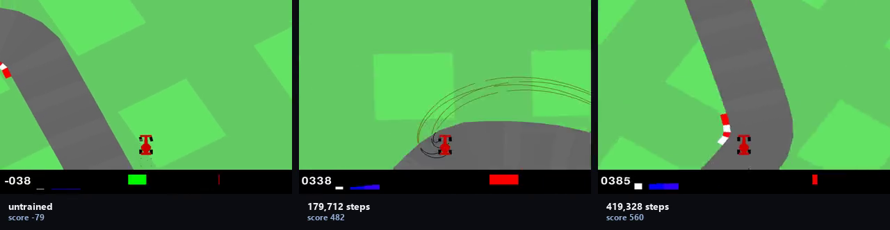

# Car racing

**The game:** CarRacing-v3 (Box2D) — `gymnasium[box2d]` on PyPI.
**How the agent plays it:** the shared arcade PPO: 84×84 greyscale, four stacked frames.

Two rounds: 419k steps, then 899k with a gentler learning rate and double the entropy bonus. The second scored 637.7 ± 33.5 against the first's 578.9 ± 49.5 — +58.8 against a bar of 119.6, inside noise. The extra budget bought nothing measurable, and that is the result for this game.

The code is the shared `arcade/` package at the root of this repository: one network and one PPO across every arcade game, so the games differ and the method does not.



*Untrained on the left, trained on the right, same episode. The labels carry the
scores measured at the resolution being filmed.*

[Eight-second demonstration](media/demo.mp4) · [as a gif](media/demo.gif)

### Result

| checkpoint | steps | return | ± se |
|---|---:|---:|---:|
| random | — | -44.88 | 3.71 |
| ckpt_000 | 0 | -41.22 | 3.22 |
| ckpt_005 | 44,544 | -18.82 | 15.98 |
| ckpt_015 | 135,168 | 292.58 | 27.91 |
| ckpt_035 | 314,880 | 416.76 | 37.92 |
| ckpt_065 | 583,680 | 541.81 | 47.67 |
| ckpt_100 | 898,560 | 600.13 | 44.95 |

*Scored on 20 selection episodes, the same ones for every row.*

Best: **ckpt_100**, re-scored on 20 held-out episodes: **637.71 ± 33.52** against **-37.91 ± 4.79** untrained — learned, +675.63 against a bar of 67.72.

### Running it

```bash
python -m arcade.train --game racing --steps 900000
python -m arcade.evaluate --game racing --episodes 12
python -m arcade.progress --game racing
```

Scored under [`protocol.py`](../protocol.py): the checkpoint ladder is scored on
one set of episodes, the best checkpoint is re-scored on a disjoint set, and a
gain counts only if it clears two standard errors of the difference.
