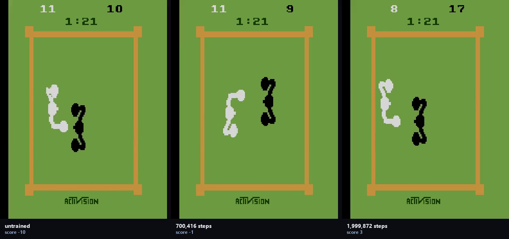

# Boxing (retired)

**The game:** Atari 2600 Boxing — ROMs shipped under licence with `ale-py`.
**How the agent plays it:** the shared arcade PPO.

Retired from the showcase for how the console looks at demo size, not for how the agent did. Its numbers are here.

The code is the shared `arcade/` package at the root of this repository: one network and one PPO across every arcade game, so the games differ and the method does not.



*Untrained on the left, trained on the right, same episode. The labels carry the
scores measured at the resolution being filmed.*

[Eight-second demonstration](media/demo.mp4) · [as a gif](media/demo.gif)

### Result

| checkpoint | steps | return | ± se |
|---|---:|---:|---:|
| random | — | -0.55 | 1.59 |
| ckpt_000 | 0 | -0.20 | 1.42 |
| ckpt_005 | 99,840 | 0.40 | 1.14 |
| ckpt_015 | 299,520 | -0.15 | 1.17 |
| ckpt_035 | 700,416 | 3.25 | 1.02 |
| ckpt_065 | 1,299,456 | -0.20 | 1.63 |
| ckpt_100 | 1,999,872 | 1.90 | 1.07 |

*Scored on 20 selection episodes, the same ones for every row.*

Best: **ckpt_035**, re-scored on 20 held-out episodes: **1.70 ± 1.81** against **-0.95 ± 1.31** untrained — inside noise, +2.65 against a bar of 4.47.

This run peaked in the middle: it lost 1 return between its best checkpoint and the end of training.

### Running it

```bash
python -m arcade.train --game boxing
python -m arcade.evaluate --game boxing --episodes 20
```

Scored under [`protocol.py`](../protocol.py): the checkpoint ladder is scored on
one set of episodes, the best checkpoint is re-scored on a disjoint set, and a
gain counts only if it clears two standard errors of the difference.
