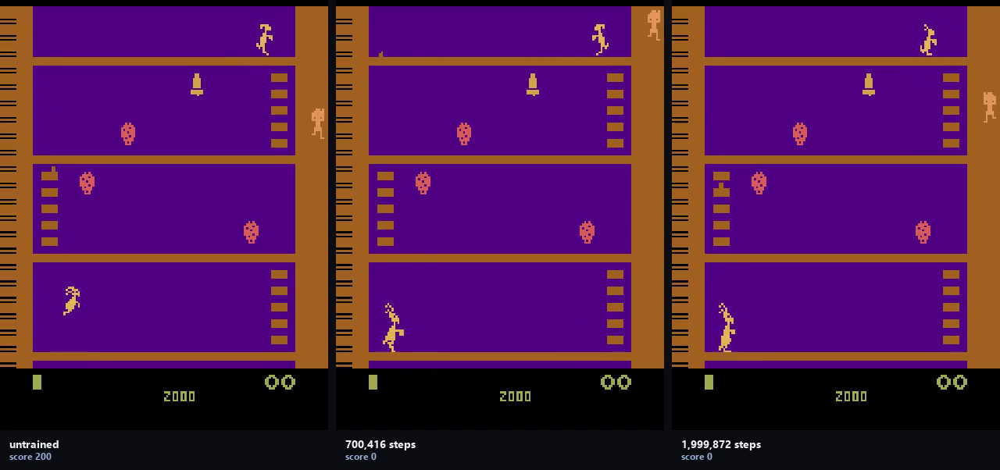

# Kangaroo (retired)

**The game:** Atari 2600 Kangaroo — ROMs shipped under licence with `ale-py`.
**How the agent plays it:** the shared arcade PPO.

A hard-exploration game: the reward needs a ladder climb and a punch in sequence, which random play almost never completes.

The code is the shared `arcade/` package at the root of this repository: one network and one PPO across every arcade game, so the games differ and the method does not.



*Untrained on the left, trained on the right, same episode. The labels carry the
scores measured at the resolution being filmed.*

[Eight-second demonstration](media/demo.mp4) · [as a gif](media/demo.gif)

### Result

| checkpoint | steps | return | ± se |
|---|---:|---:|---:|
| random | — | 50.00 | 24.60 |
| ckpt_000 | 0 | 50.00 | 24.60 |
| ckpt_005 | 99,840 | 0.00 | 0.00 |
| ckpt_015 | 299,520 | 0.00 | 0.00 |
| ckpt_035 | 700,416 | 0.00 | 0.00 |
| ckpt_065 | 1,299,456 | 0.00 | 0.00 |
| ckpt_100 | 1,999,872 | 30.00 | 16.38 |

*Scored on 20 selection episodes, the same ones for every row.*

Best: **ckpt_100**, re-scored on 20 held-out episodes: **30.00 ± 16.38** against **50.00 ± 19.87** untrained — inside noise, -20.00 against a bar of 51.50.

Not one trained checkpoint beat the network they all started from, and a random policy beats every one of them. That is the result for this game.

### Running it

```bash
python -m arcade.train --game platformer
python -m arcade.evaluate --game platformer --episodes 20
```

Scored under [`protocol.py`](../protocol.py): the checkpoint ladder is scored on
one set of episodes, the best checkpoint is re-scored on a disjoint set, and a
gain counts only if it clears two standard errors of the difference.
