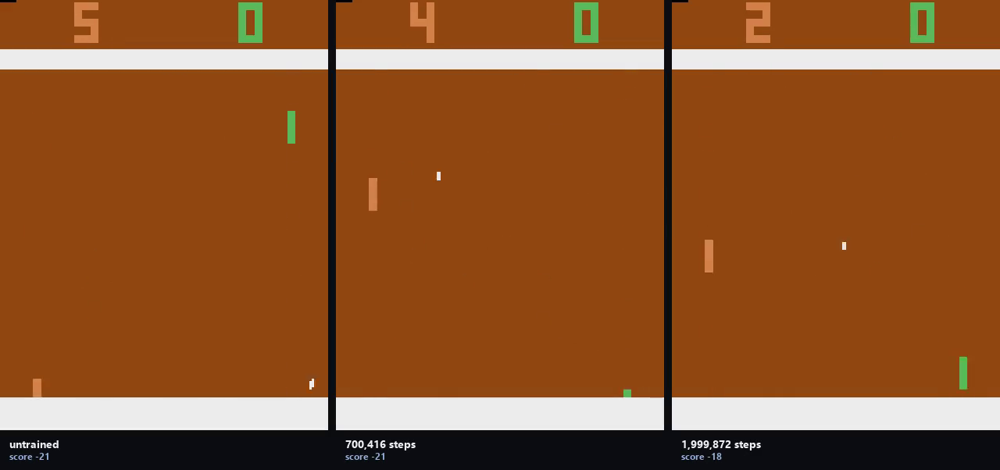

# Table tennis (retired)

**The game:** Atari 2600 Pong — ROMs shipped under licence with `ale-py`.
**How the agent plays it:** the shared arcade PPO.

The code is the shared `arcade/` package at the root of this repository: one network and one PPO across every arcade game, so the games differ and the method does not.



*Untrained on the left, trained on the right, same episode. The labels carry the
scores measured at the resolution being filmed.*

[Eight-second demonstration](media/demo.mp4) · [as a gif](media/demo.gif)

### Result

| checkpoint | steps | return | ± se |
|---|---:|---:|---:|
| random | — | -20.35 | 0.20 |
| ckpt_000 | 0 | -20.40 | 0.13 |
| ckpt_005 | 99,840 | -20.35 | 0.13 |
| ckpt_015 | 299,520 | -20.35 | 0.17 |
| ckpt_035 | 700,416 | -19.70 | 0.21 |
| ckpt_065 | 1,299,456 | -15.25 | 1.24 |
| ckpt_100 | 1,999,872 | -15.30 | 0.95 |

*Scored on 20 selection episodes, the same ones for every row.*

Best: **ckpt_065**, re-scored on 20 held-out episodes: **-13.00 ± 1.43** against **-20.25 ± 0.18** untrained — learned, +7.25 against a bar of 2.88.

This run peaked in the middle: it lost 0 return between its best checkpoint and the end of training.

### Running it

```bash
python -m arcade.train --game pingpong
python -m arcade.evaluate --game pingpong --episodes 20
```

Scored under [`protocol.py`](../protocol.py): the checkpoint ladder is scored on
one set of episodes, the best checkpoint is re-scored on a disjoint set, and a
gain counts only if it clears two standard errors of the difference.
